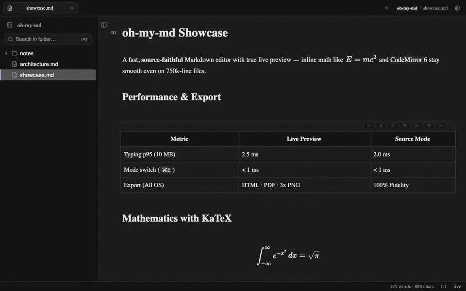
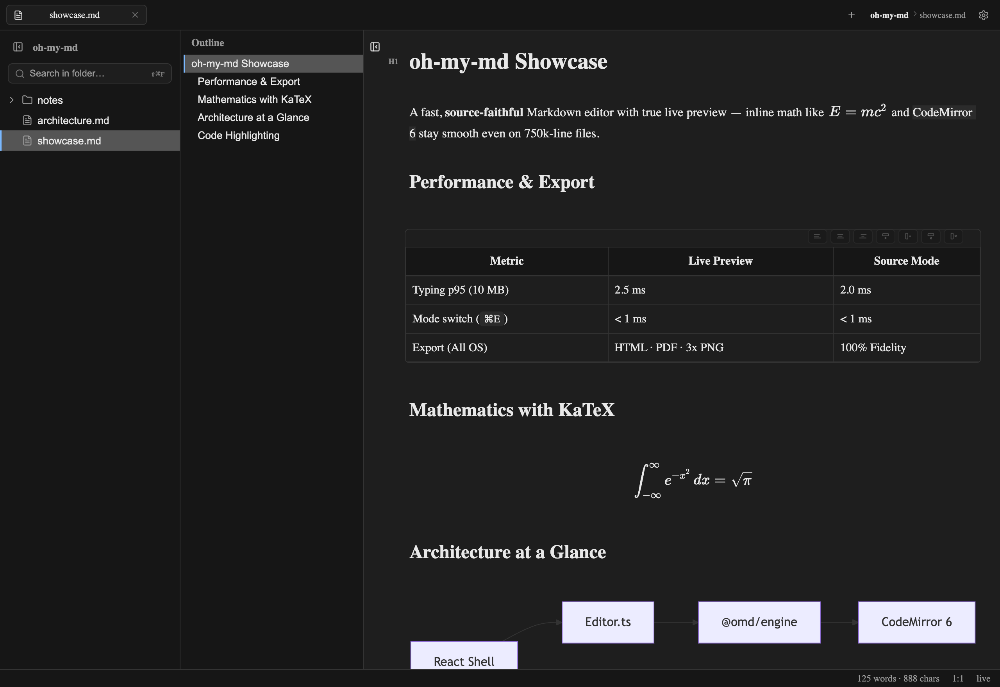
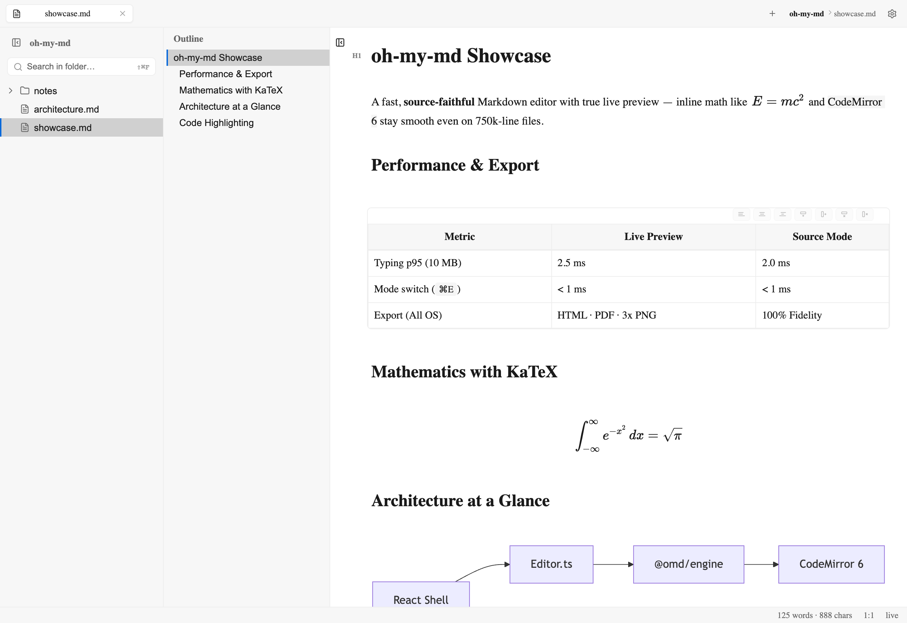

<div align="center">
  

# oh-my-md — Fast Open-Source Markdown Editor

**A free, local-first, source-faithful Markdown editor with true live preview — built with Tauri 2 & CodeMirror 6 to stay fast even on 750k-line documents.**

[**Download the latest release →**](https://github.com/Zuixi/oh-my-md/releases/latest) · [Features](#features) · [Performance](#performance) · [Shortcuts](#keyboard-shortcuts) · [Docs](#documentation) · [Roadmap](#roadmap)

[English](./README.md) · [简体中文](./README-zh.md)

[](https://github.com/Zuixi/oh-my-md/actions/workflows/ci.yml)
[](https://github.com/Zuixi/oh-my-md/releases/latest)
[](https://github.com/Zuixi/oh-my-md/releases)
[](./LICENSE)

[](./CONTRIBUTING.md)

</div>



<table>
  <tr>
    <td align="center"><strong>Dark Theme (Default)</strong></td>
    <td align="center"><strong>Light Theme</strong></td>
  </tr>
  <tr>
    <td></td>
    <td></td>
  </tr>
</table>

## Why oh-my-md?

Markdown editors usually pick one of two compromises: a split pane that separates source from output, or a rich-text document that renders beautifully and quietly rewrites your bytes on save. And a prototype is easy to build in a weekend — until a real 50,000-line file, a complex table, a CJK IME, or an external edit exposes every crack.

**oh-my-md refuses both compromises:** free, Apache-2.0, wrapped in a lightweight Tauri 2 shell, and engineered from day one for source fidelity, data safety, and very large documents.

- **Pure source fidelity (clean Git diffs)** — Live preview is a projection over your raw `.md` bytes, not a rich-text AST that silently reformats lists, escapes, or tables on save. Even in-cell table edits apply byte-minimal syntax-range patches.
- **Data-safe by architecture** — Rust double-compare atomic saving, external-change & symlink conflict detection, multi-draft crash recovery, per-window session restore, and local version snapshots.
- **Proven large-document speed** — Viewport-windowed live rendering, streaming open, and zero O(doc) hot-path work: **2 ms p95 typing on a 20 MB / 750k-line file (source mode)**, verifiable with the built-in benchmark.
- **The hard UX edges, actually solved** — direct in-cell editing on the rendered table, tight selection geometry (exact Markdown copy across rendered blocks), Smart Paste from Notion/Word/web (including `rowspan`/`colspan` tables), live KaTeX popup editing, and first-class CJK IME handling.
- **Print-grade export on every OS** — Self-contained HTML (local images and styles inlined; remote images keep their URL), **paginated native PDF**, and **1x/2x/3x high-DPI PNG** on macOS, Windows, and Linux — matching live preview 1:1.
- **Small footprint** — Tauri 2 runs in the system WebView instead of bundling a browser engine: the Windows installer is ~7 MB.

## Features

**Writing & Live Preview**
- **True live preview** — Markdown marks fade into rendered content as you type; `⌘E` flips to plain source mode in under 1 ms on typical notes (a cursor-seed build, ~6 ms p95 at 20 MB) without touching your bytes
- **Full CommonMark + GFM** — tables, task lists, footnotes (click to jump/return), strikethrough, `==highlights==`, `<mark>`, `<u>`, `:gemoji:` completion
- **In-cell tables & Smart Paste** — click directly into a rendered table cell to edit with byte-minimal range patches, or paste rich HTML from browsers/Notion/Feishu/Word (including complex `rowspan`/`colspan` tables)
- **Rich blocks** — live **KaTeX math** with an inline CodeMirror LaTeX popup editor, **Mermaid diagrams**, and **Shiki** syntax highlighting
- **Writing polish** — configurable auto-pairing (brackets, quotes, Markdown), Typewriter & Focus modes, and first-class **CJK IME** & underscore flanking (`__粗体__`) support

**Files, Workspace & Data Safety**
- **Single-file first, workspace ready** — double-click any `.md` to open immediately; open a folder for a virtualized file tree, inline create/rename, Quick Open (`⌘P`), regex Find/Replace (`⌘F` / `⌘H`), folder search (`⇧⌘F`), outline panel, and tabs
- **Local images** — paste, drag-and-drop, or pick images into a local `assets/` folder beside your document
- **Never lose a draft** — conflict-safe atomic saving, external-change detection, multi-draft crash recovery, per-window session restore, and local version snapshots
- **Privacy & opt-in diagnostics** — no account, no telemetry; diagnostic logging is off by default and exports redacted support bundles when needed (see [Troubleshooting](./docs/guides/troubleshooting-en.md) and [SECURITY.md](./SECURITY.md))

**Export (macOS · Windows · Linux)**
- **HTML, paginated native PDF, and PNG** all ship on macOS, Windows, and Linux — preserving KaTeX formulas, Shiki code highlighting, tables (including complex HTML tables), and Mermaid diagrams from live preview
- **PDF page setup** — configurable A4/Letter paper size, portrait/landscape orientation, custom margins, heading page breaks, and optional headers/page numbers
- **High-DPI PNG** — configurable width (640–1920 CSS px) and 1x/2x/3x scale in Settings

**Appearance & Localization**
- Light, Dark, and System themes (matching native window chrome and code themes), plus English and 简体中文 UI
- Custom CSS themes the editor through public tokens — override `--omd-bg`, `--omd-fg`, `--omd-link`, `--omd-cursor`, `--omd-selection-bg`, `--omd-selection-bg-unfocused`, or the `--omd-syn-*` syntax palette on `html[data-theme="dark"|"light"]`

## Performance

One promise: **you should never split a document up because of the editor.**

- Keystroke latency stays inside the 16 ms frame budget in both live and source mode — **~2.5 ms live p95 on a 350 KB richly formatted note (4,800 paragraphs), and still ~2.5 ms live p95 at 1.3 MB (13,600 paragraphs)**
- Live rendering is **viewport-windowed above 2,000 lines or 100 KB**, so those two tiers cost the same per keystroke instead of scaling with the file
- `⌘E` mode switching builds only a cursor-centred seed instead of the whole document — **under 1 ms on typical notes**, and **~6 ms p95 at 20 MB**, which is the honest upper bound rather than a size-independent constant
- The largest tiers trade live preview for safety: 10 MB / 380k lines keeps windowed live editing, 20 MB / 750k lines is a **source-mode, read-only-scale tier** where live preview is deliberately not claimed

| Document | Typing p95 (live / source) | Main-thread open (live) |
| --- | --- | --- |
| 350 KB · 4,800 formatted paragraphs | ~2.5 / 2 ms | ~10 ms |
| 1.3 MB · 13,600 formatted paragraphs | ~2.5 / 2 ms¹ | ~8 ms |
| 10 MB · 380k lines | ~2.5 / 2 ms¹ | ~15 ms |
| 20 MB · 750k lines | — / 2 ms² | ~30 ms |

¹ Viewport-windowed live rendering: only the visible window and its prune margin hold decorations, so cost tracks the viewport rather than the document.
² Source / read-only scale tier — editing stays responsive, live preview is not claimed at this size.

Figures come from the built-in advisory benchmark on an M-series machine (run-to-run p95 lands between 2.5 and 3.2 ms for the windowed tiers) — run `pnpm --filter @omd/engine bench` and see for yourself. The blocking regression gate is `pnpm check:perf`.

## Scope & 1.0 non-goals

1.0 is a **single-machine desktop Markdown editor**, on purpose:

- **In scope** — true live editing over raw Markdown, conflict-safe local files (atomic saves, external-change and symlink detection, crash recovery, version snapshots), native HTML / paginated PDF / PNG export on macOS, Windows and Linux, and a workspace that stays responsive on very large documents.
- **Explicitly out of scope for 1.0** — plugin runtimes, cloud sync and real-time collaboration, mobile apps, and AI writing assistants. These are deferred rather than half-built: no hidden sync, no background upload, no assistant surfaces in the shell.

The bet behind that scope: local, source-faithful editing is the part worth being excellent at. If you need plugins, sync, or an AI assistant today, a general-purpose editor is the better tool.

## Download

[**Download the latest oh-my-md release from GitHub Releases →**](https://github.com/Zuixi/oh-my-md/releases/latest)

| Platform | Download | Notes |
| --- | --- | --- |
| macOS | Universal `.dmg` | One package for Apple Silicon and Intel Macs |
| Windows x64 | `-setup.exe` | The NSIS installer is the only published Windows package; see the note below for managed environments |
| Linux x64 | `.AppImage` or `.deb` | AppImage is portable; deb is for Debian/Ubuntu-based systems |

> **Previously installed the MSI?** Run the `-setup.exe` wizard once — it guides you through removing the old MSI installation. If your desktop shows two shortcuts afterwards, delete the older one. MSI packages are no longer published with releases; managed environments can build one from source (`pnpm --filter @omd/desktop tauri build --bundles msi`), see [docs/guides/windows-installer.md](./docs/guides/windows-installer.md).

### Unsigned package warning

Current releases are **not code-signed**. Download only from this repository's GitHub Releases page and, when possible, verify the published `SHA256SUMS.txt`. Never disable Gatekeeper or SmartScreen globally.

**macOS (Gatekeeper):** open the `.dmg`, drag oh-my-md to Applications, then try to open it. If macOS blocks it, open **System Settings → Privacy & Security**, verify the blocked app is oh-my-md, and choose **Open Anyway**. Alternatively, Control-click the app in Finder and choose **Open**. Do not use commands that globally disable Gatekeeper.

**Windows (SmartScreen):** if Microsoft Defender SmartScreen appears, confirm the app name and that the installer came from this GitHub repository, choose **More info**, then **Run anyway**. Do not turn SmartScreen off system-wide.

### Linux

For the AppImage:

```sh
chmod +x oh-my-md_*.AppImage
./oh-my-md_*.AppImage
```

For Debian/Ubuntu:

```sh
sudo apt install ./oh-my-md_*.deb
```

If your system reports missing WebKit or desktop libraries, install the distribution packages listed in the [Tauri Linux prerequisites](https://v2.tauri.app/start/prerequisites/#linux).

### Automatic updates

Updater-capable releases (`0.1.0` and later) can update in place with the Tauri updater: the app checks a stable channel, verifies every download with a bundled minisign public key, and installs only after two separate user confirmations (download, then restart). Updates are never downloaded silently.

| Package | Automatic in-app install |
| --- | --- |
| macOS app (from the DMG) | ✅ |
| Windows NSIS (`-setup.exe`) | ✅ |
| Linux AppImage | ✅ |
| Linux deb | — ¹ |

¹ The deb package checks for updates but opens the official GitHub Release page for manual installation — a deb install is never replaced by the updater. Legacy MSI installs behave the same way, and the download button deep-links straight to the versioned `-setup.exe`; running it once migrates the install (see the note above).

- **Starting from `0.0.1`:** the originally released build cannot self-update. Install one updater-capable release (`0.1.0` or later) manually once; from then on, higher versions update from inside the app.
- **Updater trust vs. package signing:** the installer packages above are unsigned (see the warning above), yet the updater remains trusted — every updater bundle is signed with the project's minisign key, and the app verifies signatures against the public key it ships. A signature failure stops installation and points to the official GitHub Release; it never falls back to an unverified URL.

## Build from source

You need [pnpm](https://pnpm.io/) (or Corepack), a [Rust toolchain](https://rustup.rs/), and the [Tauri prerequisites](https://v2.tauri.app/start/prerequisites/) for your OS. macOS requires Xcode Command Line Tools, Linux requires WebKitGTK development libraries, and Windows requires Microsoft Visual Studio C++ Build Tools.

```sh
git clone https://github.com/Zuixi/oh-my-md.git
cd oh-my-md
pnpm install
pnpm dev        # launches the app
```

Create a native package for the current host with `pnpm --filter @omd/desktop tauri build`.

## Keyboard shortcuts

Formatting sits on familiar keys (`⌘B`, `⌘I`, `⌘1`–`⌘6`, …), and every command is reachable from the command palette (`⇧⌘P`) — nothing to memorize. See the [full shortcut reference](./docs/guides/keyboard-shortcuts-en.md). Windows and Linux use the corresponding Ctrl-based shortcuts.

## Documentation

- [Keyboard Shortcuts Guide](./docs/guides/keyboard-shortcuts-en.md) ([简体中文](./docs/guides/keyboard-shortcuts.md))
- [Logging & Troubleshooting](./docs/guides/troubleshooting-en.md) ([简体中文](./docs/guides/troubleshooting.md))
- [Windows Installer Policy (NSIS / MSI)](./docs/guides/windows-installer.md)
- [Security & Privacy Policy](./SECURITY.md)
- [Contributing Guide](./CONTRIBUTING.md) · [Code of Conduct](./CODE_OF_CONDUCT.md) · [Architecture / Agent Guides (`AGENTS.md`)](./AGENTS.md)

## Roadmap

- [ ] Code-signed packages for macOS and Windows (Apple Developer / Windows Authenticode accounts still pending)
- [x] Automatic updates — shipped for updater-capable releases (`0.1.0+`) via the minisign-verified Tauri updater
- [ ] Block-level AI actions (polish / continue / translate) via OpenAI-compatible APIs and local Ollama
- [ ] Plugin architecture — foundations already reserved in the design

## FAQ

- **Is it really free?** Yes. Apache-2.0, no account, no feature gates.
- **Where does my data live?** In plain `.md` files on your disk — nothing is uploaded, ever.
- **Windows or Linux?** All three platforms are supported; see the platform package table above.
- **Will it open my existing notes?** If they are Markdown, yes — CommonMark + GFM plus common extras such as `==highlight==`, footnotes, KaTeX math, and Mermaid.
- **What about AI?** Designed but not shipped yet — see the [roadmap](#roadmap).

## Contributing

Issues and pull requests are welcome! Start with [CONTRIBUTING.md](./CONTRIBUTING.md) for the dev setup, the per-domain test matrix, and commit conventions. `pnpm verify` should pass before you open a PR. Bug reports get their own [issue form](./.github/ISSUE_TEMPLATE/bug_report.yml); all participation is covered by the [Code of Conduct](./CODE_OF_CONDUCT.md).

## Acknowledgments

Built on excellent open source: [CodeMirror 6](https://codemirror.net/) and [Lezer](https://lezer.codemirror.net/), [Tauri](https://tauri.app/), [KaTeX](https://katex.org/), [Mermaid](https://mermaid.js.org/), [Shiki](https://shiki.style/), [React](https://react.dev/), and [Vite](https://vite.dev/). Typora's interaction design remains a standing inspiration.

## License

[Apache-2.0](./LICENSE)
