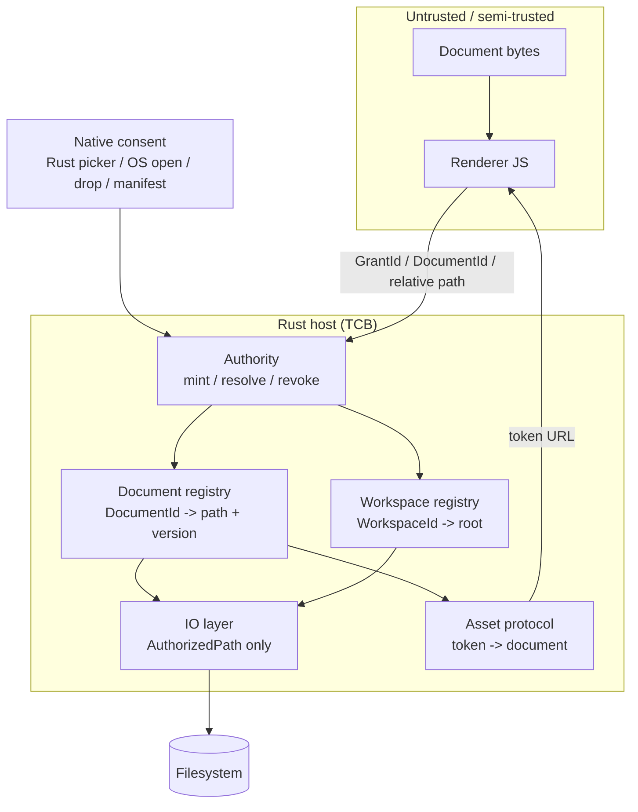

# Filesystem Authority & Renderer Security Model (Design)

> **Status:** accepted target design (2026-11-24). The current host is an interim
> implementation: Rust-owned native dialogs, per-window path scopes, and
> command-level authorization already exist; document/workspace commands still
> carry raw paths. This document defines the contract new code must follow and
> the migration target. Until the migration lands, `apps/desktop/src-tauri/AGENTS.md`
> remains the authoritative description of the interim implementation.
>
> **Supersedes in part:** [`2026-11-23-window-lifecycle-auth-and-durability-design.md`](./2026-11-23-window-lifecycle-auth-and-durability-design.md),
> specifically its residual assumption that document commands may accept any
> renderer-supplied path.
>
> **Scope:** Rust host, Tauri IPC, preload/desktop callers, document and
> workspace identity, session/recents persistence, asset serving, export, paste,
> and the renderer trust boundary.

## 1. Problem

A filesystem path is not an authorization token. Treating a renderer-supplied
path as authority creates three failure modes:

1. Every IO command is a potential general read/write surface for a compromised
   renderer; one missed check is a bypass.
2. A renderer can mint its own grants. The original `allow_workspace_dir` did
   exactly that; the interim host now narrows it through
   `authorize_requested_workspace_dir`, but the renderer still carries a path.
3. Authorization state is scattered across commands, React effects, and global
   Tauri asset scope, so lifecycle, revocation, and error handling drift.

The issue is systemic, not a missing `if` in one command. The fix is to make
renderer-originated path authority unrepresentable and to give every privileged
object one owner and one lifecycle.

## 2. Threat model

### 2.1 Trust boundaries

| Layer | Trust | Rule |
|---|---|---|
| Rust host | TCB | Owns identities, paths, native dialogs, watchers, assets, export, updates |
| Bundled renderer code | Trusted for integrity, untrusted for authority | May be compromised by XSS or a dependency; receives no ambient filesystem authority |
| Markdown content | Untrusted | Includes raw HTML, links, images, front matter, filenames, and embedded widgets |
| Remote content | Untrusted and denied by default | Remote images, diagram servers, and future network features require explicit consent |
| Same-user local processes | Out of scope | A local process with the user's rights can read/write the same files |
| OS, kernel, physical access | Out of scope | Documented, never claimed as defended |

The application boundary is **application ↔ operating system**, not
window ↔ window. Window labels are namespaces for revocation and UX isolation,
not security principals.

### 2.2 Attacks the model must stop

- A malicious document or compromised dependency reaches renderer JS and tries
  to read or replace arbitrary files.
- Path traversal, symlink escapes, Windows reparse points, Unicode/case
  aliases, or TOCTOU between validation and IO.
- Save, rename, move, export, or paste escapes its granted object.
- A renderer persists a forged path in session, settings, or recent files and
  gets it granted on the next launch.
- An asset token or global asset scope serves files after a document/window is
  closed, or serves another window's files.
- Export, custom CSS, diagnostics, or paste becomes an unrelated write/read
  primitive.

## 3. Principles

1. **Rust owns files and identity.** Rust owns document/workspace identity and
   filesystem paths; the renderer owns only UI and content.
2. **Native consent mints authority.** Grants are created only by trusted native
   origins: Rust-owned dialogs, OS open/open-with, native drag-drop, and
   Rust-written authority manifests. A renderer never grants itself a path.
3. **One resolver.** Every IO operation resolves through a single authority
   module and receives an `AuthorizedPath`/`AuthorizedFile` that no other module
   can construct.
4. **One lifecycle.** Assets, session restore, export, paste, watchers, and
   version history consume grants from the same registry and are revoked
   together.
5. **Verifiable by construction.** Types and CI prevent raw-path IO commands
   from being added; negative tests exercise the compromised-renderer case.

## 4. Target architecture



### 4.1 Capability types

```rust
pub struct GrantId([u8; 16]); // CSPRNG (UUIDv4 shape); never derived from a path

pub enum Object {
    Workspace { canonical: PathBuf },
    Document { canonical: PathBuf, lexical: PathBuf },
    ExportTarget { parent: PathBuf, name: OsString },
    CssFile { canonical: PathBuf },
}

pub struct Grant {
    id: GrantId,
    window: String,
    object: Object,
    mode: AccessMode, // Read | Write | ReadWrite
    origin: GrantOrigin, // Picker | OsOpen | DragDrop | Restored
    generation: u64,
}

pub struct AuthorizedFile { /* private fields */ }
pub struct AuthorizedPath { /* private fields */ }
```

- `AuthorizedFile`/`AuthorizedPath` constructors are private to the authority
  module. Downstream IO accepts only these types.
- Grants are bound to a window and a random id. Forging or reusing another
  window's id fails.
- `generation` invalidates in-flight async work after window reload, document
  close, rename, or revocation.
- The renderer may retain display paths for the UI, but no command that performs
  IO accepts them as authority.
- `AccessMode` is enforced by the host, not by `view.state.readOnly`:
  - `Read` allows open/stream/stat/version/snapshot reads and asset serving;
  - `Write` allows save, rename, move, delete, and paste-asset writes;
  - a read-only document grant must reject save, paste, rename, move, and delete
    even if the renderer dispatches them; export/print/copy remain read operations;
  - `ReadWrite` is the normal document grant; workspace roots may carry
    separate read and mutation grants if the product adds a restricted mode.

### 4.2 Authority API

```rust
fn mint_workspace(window, canonical) -> GrantId
fn mint_document(window, path) -> GrantId
fn mint_export_target(window, path) -> GrantId
fn mint_css(window, path) -> GrantId

fn resolve_document(window, id: DocumentId) -> Result<AuthorizedFile>
fn resolve_workspace_entry(window, id: WorkspaceId, rel: &str) -> Result<AuthorizedPath>
fn resolve_asset_token(token, rel: &str) -> Result<AuthorizedPath>
fn revoke_grant(id)
fn revoke_window(window)
```

Grant origins:

| Origin | Example | Requirement |
|---|---|---|
| Picker | `pick_open_document`, `pick_save_as`, `pick_workspace_root` | Dialog runs in Rust; grant is minted before the handle returns |
| OS open | `RunEvent::Opened`, launch argv, second instance | Rust canonicalizes and mints for the target window |
| Drag-drop | `WindowEvent::DragDrop` | Rust handles the event and mints; the renderer receives handles/events |
| Restore | Rust-written authority manifest | Revalidate existence and file identity; never trust renderer session JSON |

There is no generic `register_path`, `allow_workspace_dir`, or
`allow_document_assets` command in the target model.

### 4.3 Command classes and inventory

Target enforcement uses an explicit checked-in manifest
(`security/command-inventory.toml`):

| Class | Authority |
|---|---|
| Pure | No IO; shape validation only |
| Scoped IO | Requires `GrantId`/`DocumentId`/`WorkspaceId` or `AuthorizedPath` |
| System | `openExternal`, updater, reveal; explicit policy + user gesture |
| Internal | Not exposed to the renderer, or returns only opaque handles |

CI compares the set of commands in `tauri::generate_handler!` with the manifest
and fails when a channel is missing, unclassified, or listed as a new raw-path
IO command outside the migration allowlist. Do **not** parse command signatures
with regexes: the manifest is the reviewed contract, and the registry comparison
is the drift guard. The allowlist only shrinks. A compromised-renderer
integration test invokes every registered channel with forged arguments and
asserts no mutation outside the test sandbox.

**Current interim (Phase 0 inventory landed):** `apps/desktop/src-tauri/security/command-inventory.toml`
and `src/command_inventory_tests.rs` enforce that every registered Tauri
command is classified and that no new raw-path IO command is added outside the
shrinking allowlist. Any new or modified IO command must also use `auth_scope`,
include a negative authorization test, and state its grant origin in the
PR/security review.

### 4.4 Current versus target

| Area | Current interim | Target | Phase |
|---|---|---|---|
| Native pickers | Rust `dialogs.rs` mints per-window grants before returning paths | Renderer receives `DocumentId`/`WorkspaceId`/export handle | 1 |
| Document IO | `read/save/stat/version(path)` after `auth_scope` check | `DocumentId` + `AuthorizedFile`; save has no path | 1 |
| Workspace IO | Path + `authorize_requested_workspace_dir` + `allow_workspace_dir` | `WorkspaceId` + relative path resolver; no `allow_*` | 2 |
| Asset serving | Narrowed global Tauri `asset_protocol_scope` | Document-bound token protocol with revoke | 3 |
| Session/recents/settings | Rust validators plus renderer JSON payloads | Rust authority manifest; renderer checkpoints contain no resource paths | 2 |
| Command safety | Manual `auth_scope` calls + negative tests | Manifest/registry drift test + typed handles | 0/1 |
| Authorization errors | Typed in parts of the host; P2 cache fixed | One typed error channel with Retry/Re-pick | 0 |

## 5. Document and workspace ownership

### 5.1 Document registry

Rust owns:

```rust
struct DocumentRecord {
    id: DocumentId,
    window: String,
    grant: GrantId,
    canonical: PathBuf,
    lexical: PathBuf,
    baseline: VersionToken,
    state: DocumentState,
}
```

The renderer-facing save contract is:

```rust
#[tauri::command]
async fn save_document(
    window: tauri::WebviewWindow,
    id: DocumentId,
    contents: String,
    expected: VersionToken,
    format: SaveFormat,
) -> Result<SaveResult, Error>;
```

- No path crosses IPC for save.
- Save As opens the native dialog in Rust and mints a new document grant.
- Rename/move update the registry, watcher, assets, and UI in one host
  operation; the renderer never supplies the destination path.
- Version tokens preserve conflict detection; source text is written back
  unchanged.
- Multiple windows opening the same canonical file use per-window baselines.
  Move/rename of a file open elsewhere is refused or requires closing those
  windows first.

Current interim: `save_document(path, ...)` authorizes the path through
`auth_scope` before writing. That is safe only while every caller has obtained
the path from a Rust-owned origin; the target removes the path from the wire.

### 5.2 Workspace registry

Rust owns a per-window `WorkspaceId -> { root grant, canonical root, watch token,
status }`.

- `pick_workspace_root` runs in Rust; the renderer receives a `WorkspaceId`.
- `list_workspace(id, rel)`, `search_workspace(id, query)`,
  `watch_workspace(id)`, and create/rename/delete consume the id.
- Relative paths are joined and resolved by the authority; absolute paths,
  `..`, NUL, platform reserved names, and escapes through symlinks are rejected.
- The root grant covers Markdown content and visible directory operations;
  hidden/non-document files require an explicit document pick.
- Opening a workspace returns its grant as part of the state transition, so
  there is no separate "authorize before list/watch" promise to cache or fail.
  The historical `useWorkspaceWatcher` failure-cache bug is already fixed
  (rejections evict the cache and rethrow); the target removes that side channel
  instead of relying on the fix.

### 5.3 Session, settings, and recents

- Renderer checkpoints contain content, view, format, and readOnly only.
  Resource paths and document titles remain host-owned.
- Rust writes an authority manifest with canonical paths and file identity
  (Unix `dev+ino`; Windows volume serial + file index). On restore it validates
  existence, type, and identity before re-minting.
- A moved or replaced path becomes `Missing`/`Unavailable` and requires a user
  decision; it is never silently followed.
- `save_settings`, `save_session_state`, and recent files validate against live
  grants or the already-persisted payload. The renderer cannot launder a path
  through config.
- Recents are Rust-owned; a renderer call may only reorder/remove entries, not
  introduce an arbitrary path.

## 6. Assets

The process-global Tauri asset scope is not an authorization mechanism. Target:

1. Mint a 128-bit CSPRNG token per document grant. The URL form is
   platform-specific:
   - macOS/Linux: `omdasset://localhost/<token>/<relative-path>`;
   - Windows: `http://omdasset.localhost/<token>/<relative-path>`.
2. A custom protocol resolves the token, checks the document grant and
   generation, and serves only regular files inside the granted directory.
3. Closing the document or window revokes the token; subsequent requests return
   404. No directory listings, no traversal, no symlink escape, and
   `Cache-Control: no-store` so a revoked URL is not served from a cache.
4. Serve only allowlisted image types with a correct `Content-Type`; support
   `HEAD` and bounded `Range`, reject oversized bodies, and do not inline SVG
   into the editor origin without sanitization.
5. CSP allows both token forms and `data:` for images by default:
   `img-src 'self' omdasset: http://omdasset.localhost data:`. Remote `https:`
   images are opt-in. Recompute the CSP cross-platform string in a drift test
   rather than maintaining two literals.
6. Paste assets:
   - `paste_assets(document_id, assets)` takes no path;
   - writes only under the document's validated `assets/` directory;
   - validates magic bytes, MIME, size, count, and symlinks;
   - returns relative paths through the same grant;
   - pending batches commit/discard atomically and are removed on close.

## 7. Content and network

- CSP: `script-src 'self'`; no `unsafe-inline`, `unsafe-eval`, remote scripts, or
  `object`/`frame` origins. Keep `create`/`eval` out of the renderer.
- Tauri capabilities and plugin permissions are part of this boundary. Keep
  `capabilities/default.json` minimal; native dialog commands stay Rust-only;
  opener/updater/process permissions are reviewed as system capabilities, not
  convenient defaults.
- Development-only relaxations (dev server origin, broader CSP/connect-src) must
  be gated by build mode and covered by a release check that inspects the
  packaged CSP/capabilities. Never copy a dev exception into
  `tauri.conf.json`.
- Raw HTML is escaped by default. If HTML preview is added, render it in a
  sandboxed iframe without `allow-scripts`.
- Mermaid `securityLevel: "strict"`, KaTeX `trust: false`, Shiki output escaped;
  any `innerHTML` sink must be an allowlisted sanitizer output.
- Link schemes: `http`, `https`, `mailto`; no `javascript:`, `file:`, or
  `data:` navigation. Opening executable file types requires confirmation and
  never runs them.
- Custom CSS: user-picked only. Default: block `@import` and remote `url()`;
  this is a privacy decision even though it can break existing themes. If the
  product later supports external theme resources, expose an explicit opt-in
  and never let a theme silently phone home. Route local theme assets through
  the same asset resolver.
- Network is deny-by-default. Updates are signed; remote images/diagrams/AI are
  opt-in and fetched by Rust with HTTPS-only, no redirects (or a bounded
  allowlist), no private/link-local targets, size/time caps, and no credentials.
- Logs and diagnostics never contain document contents, secrets, or unredacted
  home paths. Follow the redaction/opt-in rules in
  [`2026-10-03-logging-and-diagnostics-design.md`](./2026-10-03-logging-and-diagnostics-design.md).

## 8. Filesystem hardening

- Validate absolute/relative shape, reject `.`/`..` and NUL, canonicalize the
  deepest existing ancestor, and re-append missing tails for save-as.
- Compare canonical path **and** file identity; never rely on string prefixes
  alone (Windows case folding, macOS Unicode normalization, UNC, reparse
  points).
- **Tier 2 (defense-in-depth):** descriptor/handle-relative IO:
  - Unix: `openat` with `O_NOFOLLOW`, `fstat` revalidation;
  - Windows: `FILE_FLAG_OPEN_REPARSE_POINT`, handle-based file identity.

  The stated non-goal excludes a malicious same-user process, so this is not a
  1.0 blocker; it matters when external sync/editing tools can race the app and
  when the handle layer is already available. Until then, canonicalize +
  revalidate identity immediately before the write.
- Writes use a same-directory temp file with exclusive create, fsync, rename,
  and parent-directory fsync where supported.
- Hard links created by the same user are out of scope, consistent with the
  same-user-process non-goal. Do not add link-count rejection unless a concrete
  product requirement appears; document the residual in the release notes.
- Reads accept regular files only; FIFOs, devices, sockets, and directories are
  rejected before blocking.
- Symlink policy: explicit document picks may record both lexical and resolved
  paths; workspace traversal never follows a link out of the root; `assets/`
  must not be a symlink.
- Run the security matrix on macOS, Windows, and Linux CI.

## 9. Lifecycle and errors

- Window created: empty authority.
- Open document/workspace: native origin mints.
- Close document: revoke document grant, asset tokens, watcher, and snapshots
  scope.
- Close window: revoke all; bump generation so stale async work fails.
- Renderer reload/crash: rotate context token and generation; drop old results.
- Rename/save-as: one host transaction updates registry, grant, watcher, assets,
  and emits the new display path.
- Authorization failures are typed UI states: `Unauthorized`, `Missing`,
  `Moved`, `PermissionDenied`, with Retry / Re-pick actions. Never convert a
  rejection into a resolved promise or a success-shaped fallback.
- Cross-window handoff requires an explicit host operation: assert the source
  window's grant, then mint for the destination. The renderer cannot move grants
  between windows.
- Read-only documents are host-enforced: save, paste, rename, and delete are
  rejected even if `view.state.readOnly` was bypassed; read-only export, print,
  and copy remain allowed.
- Multi-window policy: multiple windows may read the same canonical file. Writes
  use per-window version tokens and surface a conflict instead of last-writer-
  wins. Rename/move/delete are refused while another window has the file open,
  or coordinated through a host handoff. Never let the last writer silently win.

## 10. Verification

- Unit/property tests: containment (including symlink graphs, case/Unicode,
  Windows separators), revoke/generation, rename/save-as, token expiry.
- Negative tests: forged ids, cross-window ids, revoked ids, stale generation,
  malformed session/settings payloads.
- Compromised-renderer harness: call every classified command with adversarial
  arguments; assert the test sandbox is untouched outside granted paths.
- E2E: CSP/sandbox canary, navigation and `window.open` denied, remote images
  blocked, asset 404 after close, custom CSS cannot fetch.
- Security review checklist: every feature PR states which capability it needs,
  which native origin mints it, and how it is revoked.

Release / Tier 2 gates (not required to call the capability model complete):

- Parser fuzzing for Markdown, complex tables, Mermaid/KaTeX inputs, and the
  asset protocol; external penetration test before a security-sensitive release.
- Dependency audit (`cargo audit/deny`, lockfile/provenance), secret scan, SBOM,
  signed releases, and installer signing status from [`SECURITY.md`](../../../SECURITY.md).
- The command inventory/registry drift test (`security/command-inventory.toml` +
  `src/command_inventory_tests.rs`, landed in Phase 0), alongside negative
  authorization tests and migration-table updates.

## 11. Migration

| Phase | Work | Exit criterion |
|---|---|---|
| 0 | Threat model, inventory manifest + registry drift test, typed authorization errors | Inventory exists; P2 regression test stays green |
| 1 | Authority module; Rust-owned pickers; remove `allow_*`; document registry and ID-based save | Renderer cannot save to an arbitrary path |
| 2 | Workspace registry and ID-based list/search/watch/mutate; Rust authority manifest | Renderer cannot invent a root or restored path |
| 3 | Tokenized asset protocol; paste by document id; CSP tightening | Closed document assets return 404; no global scope as authority |
| 4 | Export/CSS/diagnostics/recents through grants; network policy | Command inventory fully classified |
| 5 | Fuzzing, penetration test, release/supply-chain gates | Security release checklist passes |

**Tiering:** Phases 0–2 are the 1.0 security baseline. Phases 3–4 are required
before plugins, AI, remote content, or a public security claim. Phase 5 is a
release gate, not a prerequisite for calling the baseline complete.

### 11.1 Implementation map

| Area | Current owner(s) | Migration |
|---|---|---|
| Authority core | `auth_scope.rs` | Split canonicalization helpers into `authority.rs`; add handle/generation types |
| Native consent | `dialogs.rs`, `recents.rs`, OS-open paths in `lib.rs` | Return handles; remove renderer-visible `allow_*` |
| Document IO | `documents.rs`, `documents/save.rs` | `DocumentId` save/read; retain version/atomic-write logic |
| Workspace IO | `workspace.rs`, `watcher.rs`, `lib.rs` | `WorkspaceId` + relative resolver |
| Assets/paste | `paste_assets.rs`, asset scope in `lib.rs` | Token protocol; document-id paste; revoke |
| Export/CSS/diagnostics | `export.rs`, `scoped_io.rs`, `diagnostics.rs` | Export/CSS target handles |
| Session/settings | `lib.rs`, `workspace.rs` | Rust authority manifest; path-free renderer checkpoint |
| Renderer callers | `desktopServices.ts`, `useWorkspaceWatcher.ts`, `appSessionInit.ts`, `pasteAssets.ts` | Handle-based calls; typed auth errors |
| Tests | Rust unit/integration, desktop Vitest, E2E | Forged/cross-window/revoked ids; registry drift; asset 404 |

The interim `auth_scope.rs` path-grant model remains in force until each phase
replaces it. No phase may add a new path-taking IO command; transitional
commands must use `auth_scope`, add a negative test, and appear in this table.

## 12. Non-goals and residual risks

- Not an OS sandbox: the app runs with the user's filesystem rights. A local
  process with the same rights, OS compromise, and physical access are out of
  scope.
- Third-party native libraries and WebView/kernel bugs remain in the TCB; keep
  dependencies minimal and audited.
- Validation plus immediate identity recheck is the baseline. Descriptor/handle-
  relative IO is Tier 2; a same-user external process racing a path is out of
  scope, while symlink swaps caused by external tools remain a residual risk.
- Installer signing is currently external-gated; in-app updates are
  minisign-verified. The security release gate must track the unsigned-installer
  status documented in [`SECURITY.md`](../../../SECURITY.md), not treat it as
  solved.
- If remote content or plugins are added later, they inherit this model: no
  ambient path/network authority, separate process for untrusted code, and
  explicit capability messages.

## 13. Related

- [`2026-11-23-window-lifecycle-auth-and-durability-design.md`](./2026-11-23-window-lifecycle-auth-and-durability-design.md) — interim per-window scope implementation.
- [`../../../apps/desktop/src-tauri/AGENTS.md`](../../../apps/desktop/src-tauri/AGENTS.md) — Rust enforcement rules.
- [`../../../apps/desktop/AGENTS.md`](../../../apps/desktop/AGENTS.md) — renderer authority contract.
- [`2026-10-03-logging-and-diagnostics-design.md`](./2026-10-03-logging-and-diagnostics-design.md) — opt-in logging and redaction.
- [`../../memory/gotchas-rust.md`](../../memory/gotchas-rust.md) — reusable traps.
- [`../../../SECURITY.md`](../../../SECURITY.md) — user-facing policy and disclosure.
